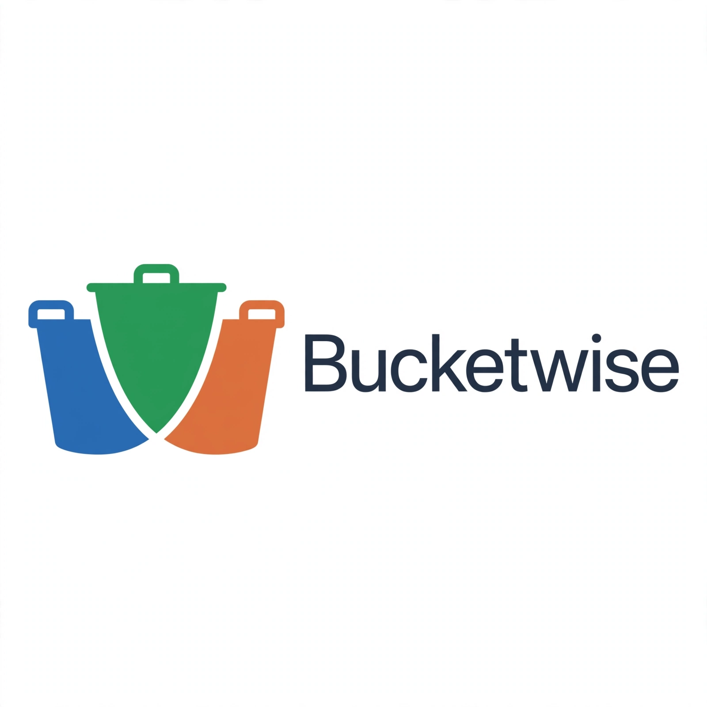

# Bucketwise — Household CFO
### Financial Freedom OS: Actions, Not Charts
**Team Bucketwise | Indie Track — Meta Global AI Developer Hackathon 2026**
**Oct 26 - Nov 4 | Submission by Nov 4, 9pm ET**


**Tagline:** Building Household CFO — Indie Track, Meta Global AI Hackathon (Oct 26-Nov 4). It turns messy family finances (Gmail, bank CSVs, 529s) into 3 buckets — Emergency, College, Life Event — with a shock-test for 2008/2020/2022 crises.

**Demo Video:** [YouTube — 2.5 min walkthrough](link-coming-Nov-1)
**Live Demo:** http://localhost:3000 (after `npm run dev`)
**Pitch Deck:** /deck

---

### The Problem We Know Firsthand
As a family in Center Valley, PA managing college savings + emergency buffer + life events, our financial picture lived in 6+ places — bank statements, Gmail receipts, 529 emails, Google Drive tax docs. Existing tools give charts. Families with buffer + simple plan survived 2008/2020/2022 better. Families without didn't.

**70M US families face this.** Average family leaks $200-400/mo in duplicate subscriptions and misses buffer targets by 8 months.

### The Solution — One Workflow
**Upload → Parse → 3 Buckets → Shock-Test → Daily Digest**

1.  **Ingest:** Upload Bank CSV or Connect Gmail/Drive (OAuth). We parse 90 days of transactions.
2.  **Bucketwise Intelligence:** Muse Wonder (long-context) reads all transactions + 529 statements → auto-allocates into **Emergency / College / Life Event** + finds leaks.
3.  **Shock-Test Simulator:** Llama 4 open-weights (hosted on Baseten/Fireworks) simulates: *Income -30% (2020-style), Expenses +20% (2022 inflation), College +6%/yr*. Output: "Need +$3200 buffer — lesson from 2008".
4.  **Daily CFO Digest:** Muse Spark generates actionable daily email: "Move $300 to Emergency, Cancel Adobe duplicate, Pause extra college for 2 months".

### Key Features (Feature Frozen Oct 30)
- **3-Bucket OS:** Emergency ($15k), College ($250k), Life Event ($30k) with progress bars
- **Leak Detection:** Finds duplicate subscriptions (Adobe x2, Spotify family)
- **Shock-Test Simulator:** Test against 2008, 2020, 2022 crises
- **SAM 3.1 Receipt Parse:** Photo → structured transaction JSON
- **Muse Image Visuals:** Auto-generated bucket cards + shock infographic

### How We Use Meta Tools — Depth Matters
This is not a wrapper. Every Meta tool does real work:

| Meta Tool | Where It Sits | Why It Matters |
|-----------|---------------|----------------|
| **Muse Wonder** (Meta Model API) | `lib/buildBucketsWithWonder()` | Long-context (90-day) financial reasoning → bucket strategy, learns from past crises |
| **Muse Spark** (Meta Model API) | `lib/ingest.ts` | Fast cashflow parse + leak detection, <2s for 500 txns |
| **SAM 3.1** | `/api/parse-receipt` | Receipt image → bounding boxes → transaction JSON |
| **Muse Image** | `/components/BucketCard` | Generates visual bucket cards + shock-test infographic |
| **Llama 4 Maverick (open-weights via Fireworks/Baseten)** | `/api/shock-test` | Private PII-safe shock simulation — raw data stays local, only anonymized summary sent |
| **Meta Model API** | Gateway for all | Single auth for Wonder/Spark |
| **Muse Code** | Used to scaffold `/api/ingest`, `/api/ingest` routes | Mentioned in build logs |

**Architecture:**
[CSV/Gmail/Drive] → [Next.js /api/ingest] → [Muse Spark: leak detection] → [Muse Wonder: bucket allocation + actions] → [Llama 4 on Baseten/Fireworks: shock-test] → [SAM 3.1: receipt photo] → UI: 3 Buckets + Daily Digest


### How to Run Locally — Stranger Test (Exit Criteria)
**Prerequisites:** Node 18+, npm

1.  **Clone:**
    ```bash
    git clone https://github.com/yourname/bucketwise.git
    cd bucketwise

2. Env Setup: Copy .env.example to .env.local:
    ```bash
    META_API_KEY=your_150_credits_key_from_dev.meta.ai
    FIREWORKS_API_KEY=...
    BASETEN_API_KEY=...
    GOOGLE_CLIENT_ID=... (optional for Gmail)
    RESEND_API_KEY=... (optional for daily digest)

3. Install & Run:
    ```bash
    npm install
    npm run dev
Open http://localhost:3000

4. Test without credits: Use sample CSV at /samples/sample-bank.csv — works with mock fallback.

## Tech Stack
**Frontend**: Next.js 16 (Turbopack), React 19, Tailwind
**Backend**: Next.js API Routes, Node
**AI**: Meta Model API (Wonder, Spark), Fireworks (Llama 4), Baseten (hosting), SAM 3.1, Muse Image
**Storage**: LocalStorage (demo) → Postgres (roadmap)
**Deploy**: Vercel

## Team Bucketwise
Solo Indie Developer — **Karthik Ramani** — Center Valley, PA
Background: Lived the problem — managing college + emergency + life events across 6 apps. Building the CFO I wish I had.

Discord: Bucketwise | Karthik | GitHub: @starlord20

Built for Meta Global AI Developer Hackathon 2026 — Indie Track
